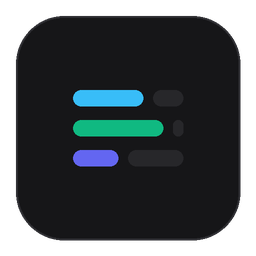

# Antigravity Tokens HUD 📊

[](https://antigravity.google)
[](package.json)
[](LICENSE)
[](https://microsoft.com)
[](#idiomas-soportados)
[](#-apoya-el-proyecto)

> **Visualizador minimalista en tiempo real de tokens, ventana de contexto y cuotas de uso para Google Antigravity 2.0.**  
> *Versión mejorada (Enhanced Fork) y optimizada para producción basada en el proyecto original [`myslithell/antigravity-tokens-hud`](https://github.com/myslithell/antigravity-tokens-hud).*

Inyectado de forma nativa e imperceptible en la barra lateral de la interfaz de **Antigravity 2.0**, ubicado estratégicamente justo encima del botón de **Settings (Configuración)**.

---

## 📸 Vista Previa


*Ubicación visual en la barra lateral de Antigravity 2.0, posicionado directamente sobre el botón **Settings**.*

---

## 💡 Tooltip Interactivo ("Acerca de")

Al pasar el cursor sobre el widget se despliega la tarjeta de información y versión sin datos redundantes:

```text
Antigravity Tokens HUD v1.1.1
Monitor en tiempo real de tokens y cuotas
───────────────────────────────────────
💡 Haz clic en el widget para alternar idioma (Siguiente: English)
(ES → EN → RU → FR → ZH)
```

---

## ✨ Características Principales

| Métrica / Función | Descripción |
| :--- | :--- |
| **Contexto de Sesión Activa** | Muestra el consumo exacto de tokens y el porcentaje de llenado de la ventana de contexto de la conversación actual (ej. `129k / 1M`). Se actualiza automáticamente al cambiar de chat. |
| **Límite Rodante de 5 Horas** | Porcentaje de cuota restante en la ventana de 5 horas y cuenta regresiva exacta para el reseteo. |
| **Cuota Semanal** | Porcentaje disponible de tu cuota semanal asignada por Google Antigravity. |
| **Tooltip "Acerca de" con Versión** | Información detallada con la versión actual (`v1.1.0`), cuotas exactas y guía de cambio de idioma. |
| **Soporte Multilingüe (5 Idiomas)** | Detecta el idioma del sistema y permite alternar dinámicamente con un solo clic. |
| **Plugin Oficial (Customizations)** | Reconocido de forma nativa por Antigravity en **Customizations > Installed**, con opción de habilitar/deshabilitar. |
| **Cero Impacto en el Agente** | Corre como un servicio local en segundo plano; no consume tokens de contexto de tus conversaciones. |
| **Arranque Silencioso** | Se inicia automáticamente con Windows a través de un script VBS en segundo plano sin ventanas de consola. |

---

## 🌐 Idiomas Soportados

El HUD detecta automáticamente el idioma de tu sistema operativo y permite alternar haciendo **clic directo sobre el widget**:

1. 🇪🇸 **Español** (`es`) — *Por defecto*
2. 🇬🇧 **English** (`en`)
3. 🇷🇺 **Русский** (`ru`)
4. 🇫🇷 **Français** (`fr`)
5. 🇨🇳 **中文** (`zh`)

---

## 🌟 Acerca de esta Derivación (Enhanced Fork)

Este repositorio es una derivación enriquecida desarrollada sobre el proyecto original de [`myslithell/antigravity-tokens-hud`](https://github.com/myslithell/antigravity-tokens-hud), transformándolo de un script experimental en inglés a una solución integral, multilingüe y lista para producción en Windows.

### 🚀 Diferencias Clave e Innovaciones

| Característica | Proyecto Base Original | Esta Derivación (`v1.1.1`) |
| :--- | :--- | :--- |
| **Persistencia y Watchdog** | Requiere reinicio manual por consola si la app se cierra. | **Daemon Inmortal (`index.js`):** Auto-reconexión a puertos dinámicos (`DevToolsActivePort`), recuperación tras reinicios de Antigravity, sincronización de estado (se oculta al deshabilitar y pausa Python) y auto-desinstalación limpia al remover en Customizations. |
| **Internacionalización** | Solo Inglés estático. | **Multilingüe dinámico:** Soporta Español (por defecto), Inglés, Ruso, Francés y Chino con autodetección de sistema y alternancia interactiva por clic persistida en `localStorage`. |
| **Integración con Windows** | Script genérico en segundo plano. | **Lanzador Nativo con Logotipo Oficial:** Ejecutable silencioso (`Antigravity Tokens HUD.exe`) con icono multirresolución (`.ico`), registro limpio en Aplicaciones de Inicio (`HKCU\...\Run`) e instaladores/desinstaladores automáticos de 1 clic (`install.bat` / `uninstall.bat`). |
| **Interfaz y Tooltip** | Métricas repetidas en tooltip. | **UX Limpia:** Tooltip estilizado con versión SemVer `v1.1.1`, guía rápida de idioma y eliminación de redundancias numéricas. |
| **Licencia y Atribución** | MIT por @myslithell. | **Preservada al 100%** bajo licencia MIT, reconociendo y acreditando la autoría base. |

---

## 🚀 Instalación Rápida

### Opción 1: Doble Clic (Instalación Local)
1. Descarga o clona este repositorio en tu equipo.
2. Haz doble clic en el archivo **`install.bat`**.
3. ¡Listo! Abre Antigravity 2.0 y el widget aparecerá de inmediato sobre el botón de **Settings**.

### Opción 2: Un Solo Comando (PowerShell)
Abre PowerShell y ejecuta:
```powershell
powershell -ExecutionPolicy Bypass -File .\install.ps1
```

*(O de forma remota una vez publicado en GitHub):*
```powershell
irm https://raw.githubusercontent.com/Collazos022/antigravity-tokens-hud/main/install.ps1 | iex
```

> **Nota:** El instalador verifica e instala automáticamente Node.js y Python 3.12 si no están presentes, y configura el arranque automático con Windows.

---

## 🗑️ Desinstalación

Para remover completamente el widget y su servicio en segundo plano:
* Haz doble clic en **`uninstall.bat`** (o ejecuta `.\uninstall.ps1` en PowerShell).

---

## 🛠️ Arquitectura Técnica

```
┌────────────────────────────────────────────────────────────┐
│                    Google Antigravity 2.0                  │
│                     (App Electron DOM)                     │
│                                                            │
│   [ Barra Lateral ] ──> client_widget.js (Inyección DOM)   │
│   [ Settings Btn  ] ──> #antigravity-token-widget          │
└─────────────────────────────▲──────────────────────────────┘
                              │ Chrome DevTools Protocol (CDP)
┌─────────────────────────────┴──────────────────────────────┐
│                  Daemon Local (index.js)                    │
│   - Escucha el puerto local DevToolsActivePort             │
│   - Consulta token_stats.py a intervalos regulares         │
└─────────────────────────────▲──────────────────────────────┘
                              │ SQLite (Modo solo lectura)
┌─────────────────────────────┴──────────────────────────────┐
│            ~/.gemini/antigravity/conversations/            │
│                 (Bases de datos locales)                   │
└────────────────────────────────────────────────────────────┘
```

---

## 💖 Apoya el Proyecto

Si este HUD te es de utilidad para optimizar tu flujo de trabajo en **Google Antigravity 2.0**, considera apoyar su desarrollo continuo:

[](https://github.com/sponsors/Collazos022)

---

## 📄 Licencia y Créditos

Este proyecto se distribuye bajo la Licencia [MIT](LICENSE).

* **Autoría del Proyecto Base:** [`myslithell`](https://github.com/myslithell) por la concepción inicial de la inyección de telemetría por CDP.
* **Derivación y Mejoras de Producción:** [`Collazos022`](https://github.com/Collazos022) — Demonio watchdog persistente, soporte multilingüe (ES, EN, RU, FR, ZH), empaquetado de arranque e instaladores de 1 clic para Windows, e identidad visual (`v1.1.0`).
